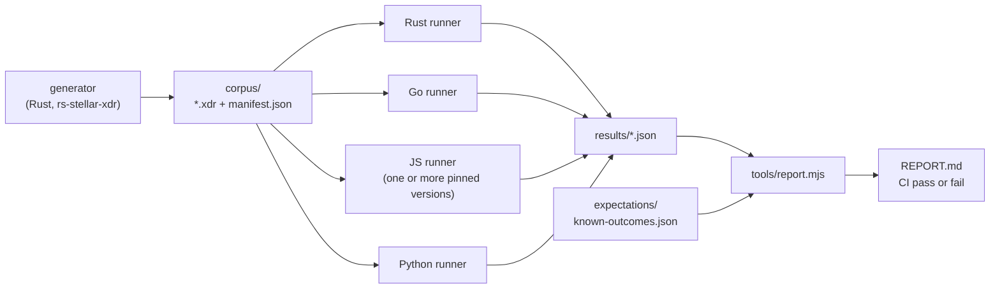

# stellar-xdr-conformance

A shared corpus of rare but valid Stellar XDR, and a runner that pushes the
same bytes through every Stellar SDK and reports where they disagree.

A decoding bug fixed in one SDK is rarely checked in the others. This
repository turns each such bug into a corpus entry with expected decoded
values, so one SDK's fix becomes every SDK's regression test.

> **Status:** proof of concept for the SCF RFP *XDR/CAP-Coverage Audit Tool
> and Indexer-Hardening Guide*. It covers one shape family (SCMap key
> collisions) across four SDKs. The [roadmap](#roadmap) lists what the full
> project adds.

## Current results

From [`REPORT.md`](REPORT.md), generated by CI on every pull request:

| Corpus entry | Rust `stellar-xdr` 30.0.0 | Go `go-stellar-sdk` v0.9.0 | JS 17.2.1 | JS 17.4.0 | Python 17.0.1 |
| --- | --- | --- | --- | --- | --- |
| `u32(1)` + `symbol("1")` | reference | no native conversion | **loses an entry** | raises an error | keeps both |
| `string("k")` + `symbol("k")` | reference | no native conversion | **loses an entry** | raises an error | **loses an entry** |
| `bool(true)` + `u32(1)` | reference | no native conversion | keeps both | keeps both | **loses an entry** |
| `u32(1)` + `i64(1)` | reference | no native conversion | **loses an entry** | raises an error | **loses an entry** |
| two distinct symbols (control) | reference | no native conversion | keeps both | keeps both | keeps both |

Every SDK decodes all five entries, re-encodes them byte for byte, and
(where it exposes xdr-json) produces the same JSON as rs-stellar-xdr. The
divergence is in conversion to native language values:

- **JavaScript 17.2.1** reproduces
  [js-stellar-sdk#1789](https://github.com/stellar/js-stellar-sdk/issues/1789).
  17.3.0 and later raise an error instead.
  See [FINDING-0001](findings/FINDING-0001-js-scvaltonative-key-collision.md).
- **Python 17.0.1** has the same defect, plus a case JavaScript does not have:
  `bool(true)` and `u32(1)` collide because `True == 1` in Python, and the
  surviving key carries the other key's value. Already reported upstream as
  [py-stellar-base#1250](https://github.com/StellarCN/py-stellar-base/issues/1250).
  See [FINDING-0002](findings/FINDING-0002-python-to-native-key-collision.md).

## How it works



1. **Generator** (`generator/`) builds each entry from a specification,
   encodes it with rs-stellar-xdr, checks that it decodes and re-encodes to
   the same bytes, and writes `corpus/entries/<id>.xdr` and
   `corpus/manifest.json`. Output is deterministic, and CI fails if the
   committed corpus differs from what the generator produces.
2. **Manifest** (`corpus/manifest.json`) records, for every entry, its CAP,
   protocol version, source, a synthetic flag, a SHA-256 and the expected
   decoded values. Its JSON Schema is in `corpus/schema/`. Field reference:
   [`docs/MANIFEST.md`](docs/MANIFEST.md).
3. **Runners** (`runners/<language>/`) each read the manifest and run every
   entry through one SDK. They need nothing from each other.
4. **Report** (`tools/report.mjs`) merges the results into a matrix and
   compares them with `expectations/known-outcomes.json`. CI fails on any
   codec failure, on any new silent data loss, and when a known defect stops
   reproducing, so an upstream fix is noticed the day it lands.

## Checks per entry

| Check | Passes when |
| --- | --- |
| `decode` | The SDK decodes the bytes without error. |
| `roundtrip` | Re-encoding the decoded value gives the original bytes exactly. |
| `structure` | The decoded value matches `expected.decoded` in the manifest. |
| `xdr_json` | The SDK's xdr-json output equals rs-stellar-xdr's (where the SDK has xdr-json). |
| `native` | The SDK's conversion to native values keeps every map entry, or raises an error. |

## Running locally

Requirements: Rust 1.87 or later, Go 1.25, Node.js 22.12 or later,
Python 3.10 or later.

```bash
./scripts/run-all.sh
```

This regenerates nothing. It checks the committed corpus, validates the
manifest, runs all four runners and writes `REPORT.md`. Each runner can also
run on its own; see the comment at the top of its source file.

## Repository layout

```
corpus/          XDR entries, manifest.json and its JSON Schema
generator/       Rust generator for the corpus
runners/         One runner per SDK: rust, go, js, python
tools/           Manifest validation and the report builder
expectations/    Known, accepted outcomes with links to upstream issues
findings/        One file per defect: upstream link, entries, versions, severity
results/         Latest runner output (regenerated by CI)
docs/            Manifest reference
```

## Adding an SDK

A runner reads `corpus/manifest.json`, runs each entry and writes
`results/<runner>-<version>.json` with this shape:

```json
{
  "runner": "java",
  "sdk": "java-stellar-sdk",
  "sdk_version": "x.y.z",
  "native_function": "name of the native conversion, or null",
  "runtime": "jdk 21",
  "results": [
    { "id": "SCVAL-MAP-KEYCOLLIDE-0001", "decode": "pass", "roundtrip": "pass",
      "structure": "pass", "xdr_json": "n/a", "native": "preserved", "detail": "" }
  ]
}
```

`native` is one of `preserved`, `rejected`, `silent-loss`, `unexpected` or
`n/a`. Add the runner to `scripts/run-all.sh` and the report picks it up.

## Roadmap

Mapped to the RFP milestones. None of this is built yet.

1. **Corpus and guide.** Per-CAP coverage, including entries captured from
   testnet and mainnet history and from a local stellar-core, reproducible
   for both passphrases and checked against stellar-core's `--check-lcm`
   goldens. Indexer-hardening guide.
2. **Replay harness and conformance.** `LedgerCloseMeta` replay through a
   documented adapter interface (mock `getLedgers` first), a reference
   adapter for wallet-backend, and the remaining shapes from the RFP:
   muxed and signed-payload addresses, maximum-length vectors, nested
   authorization trees, issuer ordering.
3. **Linter** for the three ingestion mistakes the RFP lists.
4. **Production release** with Protocol 30 coverage and a maintenance plan
   through the next protocol upgrade.

## License

[Apache-2.0](LICENSE).
