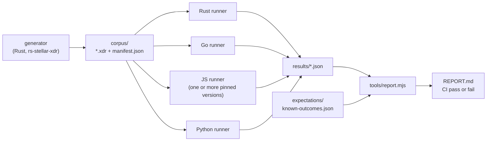

# stellar-xdr-conformance

A shared corpus of rare but valid Stellar XDR, and a runner that pushes the
same bytes through every Stellar SDK and reports where they disagree.

A decoding bug fixed in one SDK is rarely checked in the others. This
repository turns each such bug into a corpus entry with expected decoded
values, so one SDK's fix becomes every SDK's regression test.

> **Status:** proof of concept for the SCF RFP *XDR/CAP-Coverage Audit Tool
> and Indexer-Hardening Guide*. It covers one decode-side shape family
> (SCMap key collisions) across four SDKs, with synthetic entries and entries
> captured from real testnet ledgers, plus encode-side API vectors for the
> JavaScript SDK. It reproduces the three SDK sightings the RFP names for the
> conformance runner: js-stellar-sdk #1766, #1785 and #1789.

## Current results

From [`REPORT.md`](REPORT.md), generated by CI on every pull request:

| Corpus entry | Rust `stellar-xdr` 30.0.0 | Go `go-stellar-sdk` v0.9.0 | JS 17.2.1 | JS 17.4.0 | Python 17.0.1 |
| --- | --- | --- | --- | --- | --- |
| `u32(1)` + `symbol("1")` | reference | no native conversion | **loses an entry** | raises an error | keeps both |
| `string("k")` + `symbol("k")` | reference | no native conversion | **loses an entry** | raises an error | **loses an entry** |
| `bool(true)` + `u32(1)` | reference | no native conversion | keeps both | keeps both | **loses an entry** |
| `u32(1)` + `i64(1)` | reference | no native conversion | **loses an entry** | raises an error | **loses an entry** |
| two distinct symbols (control) | reference | no native conversion | keeps both | keeps both | keeps both |

Each of the four collision shapes also has a **captured** twin
(`SCVAL-MAP-KEYCOLLIDE-0101` to `-0104`): the return value of a real testnet
transaction, extracted from the `LedgerCloseMeta` stellar-core produced
(see [Core-emitted entries](#core-emitted-entries)). Every SDK gives each
captured entry the same result as its synthetic twin.

Every SDK decodes all nine entries, re-encodes them byte for byte, and
(where it exposes xdr-json) produces the same JSON as rs-stellar-xdr. The
divergence is in conversion to native language values:

- **JavaScript 17.2.1** (and 17.2.0, also pinned) reproduces
  [js-stellar-sdk#1789](https://github.com/stellar/js-stellar-sdk/issues/1789).
  17.3.0 and later raise an error instead.
  See [FINDING-0001](findings/FINDING-0001-js-scvaltonative-key-collision.md).
- **Python 17.0.1** has the same defect. It was already reported upstream as
  [py-stellar-base#1250](https://github.com/StellarCN/py-stellar-base/issues/1250),
  which lists all three cases, including `bool(true)` and `u32(1)`
  (`True == 1` in Python). The harness confirmed them independently and
  automatically, by running the same bytes it uses for JavaScript. The
  `bool`/`u32` case also shows why each SDK needs the whole corpus: it does
  not collide in JavaScript.
  See [FINDING-0002](findings/FINDING-0002-python-to-native-key-collision.md).

### API vectors

Some defects are on the encode side: the SDK refuses a value the network
accepts, or accepts an input and then encodes a different value. These are
tested with API vectors (`corpus/api-vectors.json`), whose expected values
are computed with rs-stellar-xdr.

| Sighting | Vectors | JS 17.2.0 | JS 17.2.1 | JS 17.4.0 |
| --- | --- | --- | --- | --- |
| [js-stellar-sdk#1766](https://github.com/stellar/js-stellar-sdk/pull/1766): issuers ordered as strkey text | `APIVEC-LPOOL-ISSUER-ORDER-0001`, `-0002` | **defect** | correct | correct |
| [js-stellar-sdk#1785](https://github.com/stellar/js-stellar-sdk/issues/1785): non-canonical muxed IDs accepted | `APIVEC-MUXED-ID-0002` to `-0005` | **defect** | **defect** | correct |

17.2.0 rejects a liquidity-pool asset pair that is in network order, and
accepts the reversed pair with a pool ID the network does not use. 17.2.0
and 17.2.1 accept `"0x10"`, `"016"` and `" 16 "` as a muxed ID: the address
encodes 16 while `id()` reports the string as typed. See
[FINDING-0003](findings/FINDING-0003-js-issuer-ordering.md) and
[FINDING-0004](findings/FINDING-0004-js-noncanonical-muxed-id.md).

The Go SDK (v0.9.0) and the Python SDK (17.0.1) run the same vectors. Both
order the liquidity-pool pair as the network does and produce the pool ID
rs-stellar-xdr computes. Both take a muxed ID as an integer, so the
non-canonical string vectors have no matching API there and are reported as
such; the canonical control passes. The Rust runner does not run API
vectors yet.

## Core-emitted entries

A synthetic entry proves that the XDR is valid and decodes. It does not
prove that stellar-core ever emits it. To close that gap for this shape
family:

1. `capture/contract` is a Soroban contract whose `shape(n)` returns the map
   for corpus shape `n`. The two keys are distinct ScVals, so the host
   accepts the map; they only collide after conversion to some languages'
   native maps.
2. `capture/capture.mjs` deployed it on testnet with a throwaway friendbot
   account, invoked each shape once, and saved the raw `LedgerCloseMeta`
   returned by RPC `getLedgers` for the ledger that included each call.
3. The generator extracts `TransactionMeta.soroban_meta.return_value`
   from those files offline, after checking the ledger sequence, the ledger
   hash and that the transaction succeeded. CI repeats this on every run,
   with no network access.

| Entry | Ledger (testnet, protocol 30) | Transaction |
| --- | --- | --- |
| `SCVAL-MAP-KEYCOLLIDE-0101` | 5712618 | `a7de477c…dca0fc` |
| `SCVAL-MAP-KEYCOLLIDE-0102` | 5712619 | `c5ba4fd7…ae04b5` |
| `SCVAL-MAP-KEYCOLLIDE-0103` | 5712620 | `7909b7c8…bec1f3` |
| `SCVAL-MAP-KEYCOLLIDE-0104` | 5712621 | `418be97d…416cfc` |

All four return values are **byte-identical** to the synthetic entries
`-0001` to `-0004` (recorded as `same_bytes_as` in the manifest). The
extraction was cross-checked with a second decoder, `@stellar/stellar-sdk`,
which agreed on the ledger hashes and the bytes. Full hashes, the contract ID
and the saved meta files are in `corpus/manifest.json` and
`corpus/captured/`.

Testnet is reset from time to time, after which these ledgers can no longer
be fetched. The saved `LedgerCloseMeta` files, with their SHA-256 in the
manifest, are the durable record. Comparison with stellar-core's
`--check-lcm` goldens is not done yet.

## How it works



1. **Generator** (`generator/`) builds each entry from a specification,
   encodes it with rs-stellar-xdr, checks that it decodes and re-encodes to
   the same bytes, and writes `corpus/entries/<id>.xdr` and
   `corpus/manifest.json`. Output is deterministic, and CI fails if the
   committed corpus differs from what the generator produces.
2. **Manifest** (`corpus/manifest.json`) records, for every entry, its CAP,
   protocol version, source, a synthetic flag, a SHA-256 and the expected
   decoded values. Its JSON Schema is in `corpus/schema/`. Field reference:
   [`docs/MANIFEST.md`](docs/MANIFEST.md).
3. **Runners** (`runners/<language>/`) each read the manifest and run every
   entry through one SDK. They need nothing from each other.
4. **Report** (`tools/report.mjs`) merges the results into a matrix and
   compares them with `expectations/known-outcomes.json`. CI fails on any
   codec failure, on any new silent data loss, and when a known defect stops
   reproducing, so an upstream fix is noticed the day it lands.

## Checks per entry

| Check | Passes when |
| --- | --- |
| `decode` | The SDK decodes the bytes without error. |
| `roundtrip` | Re-encoding the decoded value gives the original bytes exactly. |
| `structure` | The decoded value matches `expected.decoded` in the manifest. |
| `xdr_json` | The SDK's xdr-json output equals rs-stellar-xdr's (where the SDK has xdr-json). |
| `native` | The SDK's conversion to native values keeps every map entry, or raises an error. |

## Running locally

Requirements: Rust 1.87 or later, Go 1.25, Node.js 22.12 or later,
Python 3.10 or later.

```bash
./scripts/run-all.sh
```

This regenerates nothing. It checks the committed corpus, validates the
manifest, runs all four runners and writes `REPORT.md`. Each runner can also
run on its own; see the comment at the top of its source file.

## Repository layout

```
corpus/          XDR entries, manifest.json, api-vectors.json, JSON Schemas, captured LedgerCloseMeta
generator/       Rust generator: synthetic entries, and offline extraction of captured ones
capture/         Test contract and one-off testnet capture script (not run in CI)
runners/         One runner per SDK: rust, go, js, python
tools/           Manifest validation and the report builder
expectations/    Known, accepted outcomes with links to upstream issues
findings/        One file per defect: upstream link, entries, versions, severity
results/         Latest runner output (regenerated by CI)
docs/            Manifest reference
```

## Adding an SDK

A runner reads `corpus/manifest.json`, runs each entry and writes
`results/<runner>-<version>.json` with this shape:

```json
{
  "runner": "java",
  "sdk": "java-stellar-sdk",
  "sdk_version": "x.y.z",
  "native_function": "name of the native conversion, or null",
  "runtime": "jdk 21",
  "results": [
    { "id": "SCVAL-MAP-KEYCOLLIDE-0001", "decode": "pass", "roundtrip": "pass",
      "structure": "pass", "xdr_json": "n/a", "native": "preserved", "detail": "" }
  ]
}
```

`native` is one of `preserved`, `rejected`, `silent-loss`, `unexpected` or
`n/a`. Add the runner to `scripts/run-all.sh` and the report picks it up.

## License

[Apache-2.0](LICENSE).

## Maintainers

[@NibrasD](https://github.com/NibrasD)
