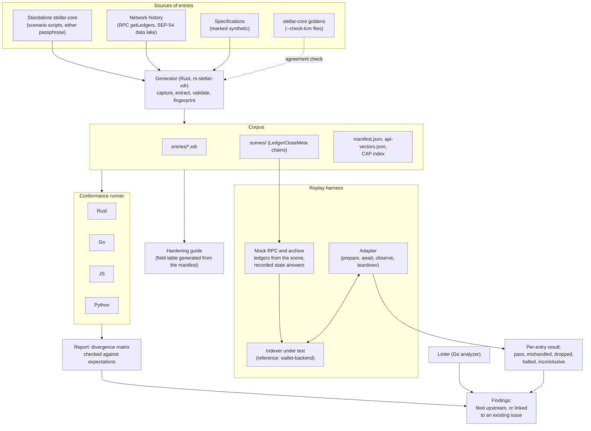
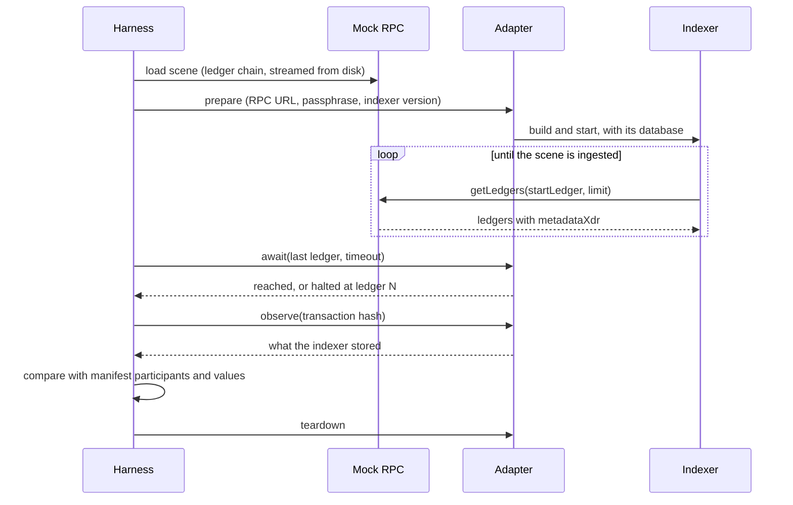

# Technical architecture

Stellar XDR Conformance Kit

## Contents

- [1. What the kit is](#1-what-the-kit-is)
- [2. Built today and planned](#2-built-today-and-planned)
- [3. System overview](#3-system-overview)
- [4. Components](#4-components)
  - [4.1 Corpus and manifest](#41-corpus-and-manifest)
    - [CAP index: scope and how completeness is checked](#cap-index-scope-and-how-completeness-is-checked)
    - [Participants: reference definition](#participants-reference-definition)
  - [4.2 Generator](#42-generator)
  - [4.3 Conformance runner](#43-conformance-runner)
  - [4.4 Replay harness](#44-replay-harness)
  - [4.5 Linter](#45-linter)
  - [4.6 Hardening guide](#46-hardening-guide)
  - [4.7 Findings](#47-findings)
- [5. Use of the Stellar stack](#5-use-of-the-stellar-stack)
- [6. Infrastructure](#6-infrastructure)
- [7. Decentralization](#7-decentralization)
- [8. User tracking and privacy](#8-user-tracking-and-privacy)
- [9. Security](#9-security)
- [10. Maintenance](#10-maintenance)
- [11. Licence](#11-licence)
- [12. Scope limits and why](#12-scope-limits-and-why)
- [13. Delivery plan](#13-delivery-plan)
- [14. Risks](#14-risks)

## 1. What the kit is

Software that reads the Stellar ledger has to decode XDR. Rare but valid
shapes keep breaking indexers and SDKs, and each team finds the same bugs on
its own. The kit is one shared set of test data and tools:

| Component | What it does | Who uses it |
| --- | --- | --- |
| **Corpus** | Rare, valid XDR: one entry per shape, tagged with its CAP and protocol, with expected decoded values | Everyone below |
| **Generator** | Produces and re-derives the corpus from a standalone stellar-core, network history, or a specification | Corpus maintainers |
| **Conformance runner** | Runs the corpus through the JS, Go, Rust and Python SDKs and reports where they diverge | SDK maintainers |
| **Replay harness** | Feeds corpus ledgers to an indexer and reports what it mishandles, drops, or halts on | Indexer teams |
| **Linter** | Static-analysis rules for three ingestion risks in Go indexer source; the third rule is a heuristic | Indexer teams |
| **Hardening guide** | Explains which fields core validates, recommended caps, and correct address handling | Indexer authors |

## 2. Built today and planned

| Area | In this repository today | Planned with the award |
| --- | --- | --- |
| Corpus | 11 entries: 5 synthetic `ScVal` entries; 4 `ScVal` entries extracted from real testnet `LedgerCloseMeta` (protocol 30), byte-identical to their synthetic twins; 2 CAP-0040 signed-payload `SignerKey` entries extracted from real testnet `LedgerCloseMeta` (64-byte and 1-byte payloads). 7 API vectors | Per-CAP coverage manifest through Protocol 30 (structural and behavioral records); ledger-level scenes; agreement with stellar-core goldens |
| Manifest | JSON Schema, validator that checks bytes on disk | Scene, locator, participant and coverage fields |
| Generator | Deterministic synthetic entries; offline extraction from saved `LedgerCloseMeta`; `--check` mode | Scenario runner on a standalone stellar-core for both passphrases; history capture; arm-coverage tool; agreement check with stellar-core goldens |
| Conformance runner | Rust, Go, JS (three pinned versions) and Python runners for `ScVal` and `SignerKey` entries; API vectors in JS, Go and Python; divergence matrix; expectations file that fails CI on drift. Reproduces js-stellar-sdk #1766, #1785 and #1789 on pre-fix pins | API vectors in Rust; all RFP shape families; one-command use from an SDK's own CI |
| Replay harness | Component-level only: one testnet scene (wallet-backend #677) whose participants are derived from the ledger meta, run through wallet-backend's own participant code at a pinned commit (`dropped`), with a control patch that passes | Mock RPC server (ledger methods from scenes, recorded `getLedgerEntries` and `simulateTransaction`, local history archive), adapter interface, wallet-backend reference adapter |
| Linter | Not built | Go analyzer with three rules |
| Guide | Not written | Field-by-field guide, ready for developers.stellar.org |
| CI and supply chain | GitHub Actions pinned to commit SHAs; pinned Rust toolchain; npm, Go and Cargo lockfiles; hash-locked Python install | Same rules for every new component |

## 3. System overview

In plain English: the generator turns real ledger data into small files plus
a manifest that says what each file must decode to. The conformance runner
gives those files to every SDK and compares the answers. The replay harness
pretends to be a Stellar RPC server, hands the same ledgers to an indexer,
and checks what the indexer stored. The linter looks for the coding mistakes
behind the failures, and the guide explains how to avoid them. Every defect
is filed in the affected project, or linked to the issue that already
reports it.

## 4. Components

### 4.1 Corpus and manifest

Two kinds of entries:

- **Value entries**: one XDR value (for example an `ScVal` or a
  `TransactionEnvelope`) in `corpus/entries/<id>.xdr`. Used by the
  conformance runner.
- **Scenes**: a contiguous chain of `LedgerCloseMeta` produced by one run of
  a scenario. Value entries extracted from a scene point back to it with a
  locator (ledger sequence, transaction hash, field path). Used by the
  replay harness. Today one single-ledger scene is recorded in
  `corpus/scenes.json`, with its raw meta under `corpus/captured/`;
  multi-ledger chains will live in `corpus/scenes/<scene>/`.

The manifest is the contract between the corpus and every consumer. Today
each entry records: stable ID, XDR type, file, length and SHA-256, CAP,
protocol version (introduced and observed), a `synthetic` flag, the source
(network passphrase, ledger, ledger hash, transaction hash, the saved raw
`LedgerCloseMeta` and its SHA-256), the expected decoded values in a
language-neutral typed form, the expected xdr-json, and the rule a native
conversion must follow. Field reference: [`MANIFEST.md`](https://github.com/NibrasD/stellar-xdr-conformance/blob/main/docs/MANIFEST.md).

Planned additions:

- `participants`: the accounts and contracts a transaction affected,
  computed from the ledger meta by the generator under the definition
  below. The replay harness compares an indexer's output with this. It is
  already recorded for the scene in `corpus/scenes.json`; it will be added
  to every scene-derived entry.
- `fingerprint`: the set of XDR union arms the entry exercises, plus size
  classes such as "vector at maximum length", nesting depth, the shape of
  any authorization tree, and the kinds of ledger meta change involved
  (created, updated, removed, restored). The rules are published with the
  manifest schema. Two entries count as distinct shapes only if their
  fingerprints differ, so the corpus size is measured in fingerprints, not
  files. The four captured `ScVal` entries share their fingerprints with
  their synthetic twins: they show that core emits those shapes, and they
  do not count as new shapes.
- **CAP index** (`corpus/caps.json`): the per-CAP coverage manifest the RFP
  asks for, built as described below.

**API vectors** (`corpus/api-vectors.json`) cover defects on the encode
side, where an SDK refuses a value the network accepts or accepts an input
and encodes something else. Expected values are computed with rs-stellar-xdr.
They test how an SDK's API reads what a developer passes to it, not what
the network rejects. The muxed ID strings (`"0x10"`, `"016"`, padded,
empty) are API input canonicalization cases: the SDK must refuse the string
or encode exactly the canonical ID. A vector whose expected value is a
network rule is also confirmed by core: the liquidity-pool pair order is
checked against a core-emitted pool-share trustline in tranche 1, so the
expected value does not rest on rs-stellar-xdr alone.

#### CAP index: scope and how completeness is checked

The index has two kinds of record, because not every change a CAP makes
is a change to XDR.

1. **Structural records** are built from the XDR definitions, not from a
   list of CAPs written from memory. A script diffs the released `.x`
   definitions between consecutive protocol versions (the definitions
   stellar-core builds as current at each protocol release; definitions
   for the next protocol are ignored until they ship) and lists every added
   or changed type, union arm and field. Each change is classified by the
   file it is in: ledger and transaction XDR, ledger meta, contract spec,
   overlay, or internal. Overlay and internal changes do not appear in the
   ledger data an indexer reads, so they are mapped to an exclusion of that class rather than
   one by one; a conditional section is recorded with its condition. Every
   other change must be mapped to the CAP that made it and to at least one
   corpus entry, or to an exclusion with a stated reason. An unmapped
   change fails CI, so a CAP that changed XDR cannot be left out by
   oversight. XDR that predates the earliest version in that history is the
   baseline and is covered by shape family.
2. **Behavioral records** cover changes a CAP makes that matter to an
   indexer but do not show up as a new type, arm or field. CAP-0073 is an
   example: a trustline created through a Stellar Asset Contract call is a
   ledger change the indexer must read from the meta, and wallet-backend
   #731 recorded no state change for it. These records are written by hand
   from the CAP text and the RFP's failure modes, and each must point to a
   replay scene that shows the behavior.

Each record states the CAP, the protocol version, the kind of change
(structural or behavioral), the affected type or behavior, and the corpus
entry IDs or the reason for exclusion.

Coverage today, stated exactly:

| CAP | In the corpus today | Planned |
| --- | --- | --- |
| CAP-0046 (Soroban values) | 9 `ScMap` entries: 5 synthetic, 4 captured | Remaining `ScVal` arms, nested values, authorization trees |
| CAP-0038 (liquidity pools) | 2 API vectors | Core-emitted pool-share trustline whose issuers sort differently by strkey and by bytes |
| CAP-0027 (muxed accounts) | 5 API vectors | Muxed source and destination in envelopes and meta |
| CAP-0040 (signed-payload signers) | 2 `SignerKey` entries captured on testnet: 64-byte payload (maximum) and 1-byte payload (3 bytes of padding); all four SDKs agree | A replay scene of the same `SetOptions` for wallet-backend #729 |
| CAP-0073 (trustline created by the Stellar Asset Contract) | None | SAC-created trustline (wallet-backend #731) |
| CAP-0023 and CAP-0033 (claimable balances, sponsored reserves) | 1 replay scene captured on testnet (wallet-backend #677) | Value entries for the claimable-balance and sponsorship arms |
| Every other CAP that changed XDR | None | Listed by the diff script; each mapped to an entry or an exclusion |

#### Participants: reference definition

The replay harness judges an indexer against this set, so it is defined
here rather than left to judgment. For one transaction the generator
derives participants from the `LedgerCloseMeta`, never from the envelope:

| Class | Derived from |
| --- | --- |
| `fee` | Owners of entries changed in the transaction's fee processing |
| `state` | Owners of entries created, updated, removed or restored in the transaction-level changes and in each operation's changes |

Addresses that appear in the topics or data of contract and transaction
events are not participants by this definition: an event can name an
address that the transaction did not affect. They are recorded separately
as `event_addresses`, each with where it appeared (event index, topic
position or data path), and the harness reports differences in them as
information, not as `dropped`. An account whose state an event describes,
such as the recipient of a Stellar Asset Contract transfer, is already a
participant through the change to its own entry.

Rules:

- **Owner of an entry.** Account entry: the account. Trustline, offer and
  data entry: the account in the entry's key. Contract data: the contract.
  Claimable balances, liquidity pools, contract code and TTL entries have
  no owner and are recorded by ID, not as participants. A sponsor appears
  through the change to its own account entry.
- **Meta versions.** All five `TransactionMeta` versions the XDR defines
  (V0 to V4) are handled, and the version is recorded on the entry.
- **Failed transactions.** They have fee and transaction-level changes but
  no operation changes; participants are taken from what is there.
- **Fee-bump transactions.** The fee source and the inner source are both
  reported, each from the changes that name it.
- **Muxed accounts.** The participant is the base `G...` account, which is
  what ledger entries hold. The muxed ID comes from the envelope, so it is
  recorded separately and marked unvalidated.
- **Signer keys**, including signed-payload signers, are data on an account
  entry, not participants. They are recorded under `addresses` so that
  truncation can be checked.

The `fee` and `state` classes are implemented today in the generator
(`generator/src/scenes.rs`) and used by the #677 scene; `event_addresses`,
the fee-bump and muxed rules are planned. The full definition will be
published as `docs/PARTICIPANTS.md`, with at least one corpus entry per
rule, as part of tranche 1 (D1.1); it is not in the repository yet. An indexer may record more than this set (the
envelope source, for example): the harness reports a missing participant
as `dropped` and extra ones as information only.

Why this matters: wallet-backend
[#677](https://github.com/stellar/wallet-backend/issues/677), open at the
time of writing, reports that `participantsForMeta` reads only the V0
`Operations` field of `TransactionMeta`, so on V1 to V4 meta it contributes
nothing. We confirmed that reading in the source at commit `3e22515`.

### 4.2 Generator

Written in Rust on `stellar-xdr`. Three sources, in order of preference:

1. **Standalone stellar-core.** A scenario script submits the transactions
   that produce a shape to a local network (stellar-core and stellar-rpc in
   pinned containers, no peers), and the generator saves the
   `LedgerCloseMeta` chain. The network passphrase is a parameter, so each
   scene is generated once with the testnet passphrase and once with the
   mainnet passphrase. Nothing touches mainnet and no real keys or funds
   are used: accounts are throwaway keys funded from the standalone root
   account.
2. **Network history.** For shapes that only older protocols produced, or
   that a public ledger already contains, the generator fetches the ledger
   with RPC `getLedgers` or from a SEP-54 data lake (the public Stellar data
   lake needs no credentials) and saves the raw meta. The six captured
   value entries in this repository were obtained this way from real
   testnet `LedgerCloseMeta`: four `ScVal` collision entries and two
   CAP-0040 signed-payload `SignerKey` entries. A separate captured
   ledger scene reproduces wallet-backend #677.
3. **Specification.** A value built directly with rs-stellar-xdr, marked
   `synthetic: true`. Used when the first two are not possible, and always
   visible as such in the manifest.

Capture is the only step that uses a network. Extraction runs offline from
the saved files: the generator checks the ledger sequence, the ledger hash
and that the transaction succeeded before it takes anything from a file,
and CI repeats the extraction on every run.

Reproducibility is defined precisely. Re-running a scenario gives new
ledger close times, so ledger hashes differ between runs. The recorded scene
is therefore committed and hash-pinned, and a fresh run is compared with it
at the level that must be stable: decoded structure and fingerprint.
`generator --check` fails CI if any committed file differs from what the
generator derives.

**Agreement with stellar-core goldens.** stellar-core checks golden
`LedgerCloseMeta` files in its own CI (`--check-lcm`, stellar-core#5435).
That command validates stellar-core's own test output against its golden
files; it says nothing about this corpus. The kit runs a separate
extraction and agreement check against the golden files, and running
`--check-lcm` alone does not establish corpus coverage. "Agreement" means
the following chain, run in CI at a pinned stellar-core commit:

1. **Integrity.** The SHA-256 of every golden file and of its `index.json`
   is recorded, and the protocol version stamped in the index is checked
   against the protocol the corpus targets.
2. **Codec.** Every golden decodes and re-encodes byte for byte with the
   corpus's rs-stellar-xdr version.
3. **Golden-sourced entries.** Where a golden contains a shape the corpus
   needs, the entry is extracted from the golden itself. Its source records
   the stellar-core commit, the golden's hash, the ledger sequence inside
   the file and the locator path, so the entry's bytes can be re-derived
   from the original file.
4. **Cross-source agreement.** When the same shape also exists as an entry
   from a standalone network or from network history, the two must have the
   same fingerprint; any difference in decoded structure is reported.
5. **Coverage.** Every arm a golden exercises under a covered CAP must be
   exercised by a corpus entry, or appear in a published gap list.
6. **Independent oracle.** Extraction is repeated by a second, unrelated
   implementation from the same raw file and locator, and the bytes must
   equal the Rust result. Today this runs in CI for all six captured
   entries with the JavaScript SDK (`runners/js/crosscheck.mjs`); for
   golden-sourced entries the Go SDK is added. Expected values are
   therefore never produced and checked by one codec alone.

The goldens come from stellar-core's test suite, not from a public network,
so there is no network ledger hash to compare them with. Their integrity
rests on the pinned commit and the file hashes.

### 4.3 Conformance runner

One small runner per SDK. Each reads the manifest, runs every entry, and
writes a result file in a common JSON shape. Runners share no code, so a
bug in one cannot hide a bug in another.

| Check | Passes when |
| --- | --- |
| `decode` | The SDK decodes the bytes |
| `roundtrip` | Re-encoding gives the original bytes exactly |
| `structure` | The decoded value equals `expected.decoded` |
| `xdr_json` | The SDK's xdr-json equals rs-stellar-xdr's, where the SDK has it |
| `native` | Conversion to native values keeps every entry or raises an error |
| API vectors | The SDK accepts, rejects or normalizes an input as the vector requires |

`tools/report.mjs` merges the results into a divergence matrix and compares
it with `expectations/known-outcomes.json`. CI fails on a codec failure, on
a new defect, and when a known defect stops reproducing. The last rule means
an upstream fix is noticed the day a pin is bumped, and a pre-fix pin that
stops failing shows the harness can no longer detect the bug.

API vectors run today in JavaScript, Go and Python; an SDK with no
matching API reports `n/a` (Go and Python take a muxed ID as an integer, so
the non-canonical string cases do not apply to them). Planned: API vectors
in Rust; the remaining shape families
the RFP lists (muxed source and recipient accounts, offer IDs, vectors at
maximum length, nested authorization entries, ScVal map-key ordering); and a
single command plus a reusable GitHub Actions workflow so an SDK repository
can run the corpus in its own CI against its own working tree.

### 4.4 Replay harness

**Input.** The harness feeds ledgers through a mock RPC endpoint, the
input the RFP lets a proposal choose first. wallet-backend's default ledger
backend is RPC, and any pipeline that reads RPC can be pointed at the mock
without code changes. An export of the same scenes in the SEP-54 data lake
layout (`<partition>/<batch>.xdr.zst` files of `LedgerCloseMetaBatch`, with
`.config.json`), which stellar-etl and wallet-backend's `datastore` backend
read, is the natural second input; it is outside this award.

**Everything the indexer needs, served locally.** An indexer that cannot
start proves nothing about its XDR handling, so the harness supplies each
dependency explicitly:

| Dependency | How the harness provides it |
| --- | --- |
| Ledgers | `getLedgers` (`startLedger`, cursor pagination, `limit`; `hash`, `sequence`, `ledgerCloseTime`, `headerXdr`, `metadataXdr`), `getLatestLedger`, `getHealth` and `getNetwork`, computed from the scene |
| Ledger state and simulation | `getLedgerEntries` and `simulateTransaction`. Their answers depend on ledger state, so they are recorded: when a scene is generated, the adapter runs once in record mode against the standalone network's real stellar-rpc through a proxy, which saves each request and response in the scene, keyed by method and canonical parameters. In replay the mock answers from that file |
| History archive | The standalone network publishes its archive to a local directory. The scene stores the checkpoint files from that same run, with the checkpoint's ledger sequence, network passphrase and file hashes in the manifest. The harness serves them over HTTP at the URL the adapter gives the indexer, and refuses a checkpoint that does not precede the scene's first ledger or belongs to another network |
| Database and other services | Started by the adapter in containers, empty for every run |

In wallet-backend's source at commit `3e22515`, the RPC client calls
`getHealth`, `getLedgers`, `getLedgerEntries` (protocol setup and protocol
state) and `simulateTransaction` (token metadata), and the ingest service
reads an archive checkpoint on first start (`--archive-url`,
`--checkpoint-frequency`).

A request the mock has no answer for is never guessed. It returns a JSON-RPC
error, is listed in the report as an unmocked call, and makes the run
`inconclusive`. Before any rare shape is judged, the harness replays a
control scene of ordinary transactions; if the indexer does not ingest it
correctly, every result of that run is `inconclusive`, not `pass` or a
defect.

**Adapter interface.** An adapter is an executable that speaks JSON on
standard input and output, so it can be written in any language:

| Command | Purpose |
| --- | --- |
| `prepare` | Build and start the indexer and what it depends on |
| `await` | Wait until the indexer has ingested a given ledger, or report where it stopped |
| `observe` | Return what the indexer recorded for a transaction: participants, addresses, state changes |
| `teardown` | Stop and clean up |

**Results.** For each entry: `pass`; `mishandled` (the indexer stored
something that disagrees with the manifest, such as a truncated address);
`dropped` (a participant or state change in the manifest is missing from
what it stored); `halted` (ingestion stopped or retried the same ledger
past the timeout); or `inconclusive` (the run could not judge the entry, as
described above).

**Reference adapter: wallet-backend.** Written in Go. It builds
wallet-backend at a chosen commit, starts it with PostgreSQL and TimescaleDB
in containers, sets `LEDGER_BACKEND_TYPE=rpc`, and points `--rpc-url` and
`--archive-url` at the harness.

The acceptance test is the RFP's. Each case runs as its own job with an
empty database, a fixed scene and a pinned commit. The commits below were
identified from the wallet-backend history; reproducing the stated behavior
on them is the deliverable.

| Case | Pre-fix commit | Fixed commit | Expected before | Expected after |
| --- | --- | --- | --- | --- |
| [#716](https://github.com/stellar/wallet-backend/issues/716): muxed address stored truncated | `79ea2acd1dc65a07166133cc04b12e76db314db0` | `6e5a59101158dc2996295450190142366062cd05` (PR #693) | `mishandled` | `pass` |
| [#729](https://github.com/stellar/wallet-backend/pull/729): signed-payload signer, same ledger retried forever | `2a0a84ea12523b6c92e278c0c84b443041240095` | `2c873353c1f0f3c9b145e25a7d009023ad104a1c` | `halted` | `pass` |
| [#731](https://github.com/stellar/wallet-backend/issues/731): SAC-created trustline, no state change recorded | `764a4f5bcbff5abb0949d93da37f769063013ea0` | `c152783c054c765c8b51fd26ed313fd1ebc1c50c` (PR #734) | `dropped` | `pass` |

Two details from the history. First, #716 names more than one producer of
over-long addresses: the muxed-address part was fixed in `6e5a591`, and the
signed-payload signer part in `2c87335`, the #729 fix. Second, all three
pre-fix commits build against go-stellar-sdk v0.7.3, the protocol 28
release, so their scenes are generated on a standalone network at
protocol 28 and the manifest records that version.

After these three, wallet-backend #677 is added as a fourth case. It is
open, so this is a reproduction of an existing issue, not a pre-fix and
fixed comparison, and no fixed commit is claimed. Its scene already exists:
`SCENE-SPONSORED-CB-CLAIM-0001`, testnet ledger 5777140 (protocol 30), in
which claiming a sponsored claimable balance changes the sponsor's account
entry in the operation meta. Today the repository runs wallet-backend's own
`GetTransactionParticipants`, unmodified, on that transaction at commit
`3e22515a44979fdc3a558fda3991ca2b48e38cef`: the result is `dropped`, the sponsor is missing. A local control
patch that reads every change in the meta passes, which shows the
comparison separates a correct result from a wrong one. The deliverable is
the same scene through the full harness against the running indexer. The
result is linked to the existing issue, not filed again.

**Memory.** The mock streams ledgers from disk one batch at a time and never
holds a scene in memory. CI runs the full corpus under a fixed memory limit
and fails if the harness exceeds it.

### 4.5 Linter

A Go analyzer built on `golang.org/x/tools/go/analysis`, for indexers that
use the Go SDK's `xdr` and `ingest` packages. Go is the language of
wallet-backend and stellar-etl. Three rules, one per mistake in the RFP:

| Rule | Flags |
| --- | --- |
| `XDR001` | A value from a field stellar-core does not validate (memo, muxed ID, authorization tree) reaching a database write, map key, index or allocation size without passing a check |
| `XDR002` | Recursion over `ScVal` or authorization invocations with no depth limit, and allocation sized by an XDR-supplied length with no cap |
| `XDR003` | Likely cases of participants derived from envelope fields instead of the ledger meta. A heuristic, reported as a warning |

It runs standalone or through `go vet -vettool`, and prints findings with
rule IDs as text or JSON.

**What the analysis can and cannot see.** These rules are static analysis,
and the limits are part of the design:

| Aspect | Design |
| --- | --- |
| Engine | `go/analysis` on SSA form. Interprocedural through analyzer facts exported per function (for example "returns an envelope-derived value" or "bounds depth"), across the packages analyzed in one run |
| Sources | A configurable list of SDK accessors for unvalidated fields, generated from the guide's field table |
| Sinks | Arguments to `database/sql` and pgx exec and copy calls, map and slice indexes, `make` sizes |
| Sanitizers | Functions marked with an `//xdrlint:validates` directive or listed in the configuration, and comparisons that bound a length or depth |
| `XDR003` | A heuristic, reported as a warning: it flags code that builds a participant collection from envelope accessors when no meta-derived value reaches the same collection, and code that reads one `TransactionMeta` version arm directly without handling the others (the pattern in wallet-backend #677). It cannot prove that meta is never read elsewhere in a system |
| Known false negatives | Flows through interfaces, reflection, channels and database round trips. These are listed in the rule documentation |

Each rule ships with fixtures of code that must be flagged and code that
must not, checked with `analysistest`. Acceptance, matching the RFP's
"flags seeded violations, runs clean on current wallet-backend": every
seeded violation is flagged, and no fixture of correct code is flagged. On
the pinned current wallet-backend `main` commit, "clean" means no false
positive and no untriaged finding; it does not mean zero findings. While
wallet-backend #677 is open, `XDR003` is expected to report its pattern
(code that reads one `TransactionMeta` version arm and ignores the others).
That finding, and any other true positive, is listed in the linter report
as a known finding linked to its upstream issue, or filed. If #677 is fixed
upstream before acceptance, the analyzer is run on the commits before and
after the fix, and must report the pattern on the first and not on the
second. A false positive tightens the rule. The guide carries the same three checks as a checklist
for other languages.

### 4.6 Hardening guide

Markdown for developers.stellar.org, with the outline the RFP fixes:
validated and unvalidated fields; depth and size caps; deriving participants
from meta; muxed and signed-payload addresses, including the strkey forms in
SEP-0023; a self-audit checklist. The field-by-field table is generated from
a data file that CI cross-checks against the manifest, so the guide and the
corpus cannot drift apart. Each row cites the stellar-core code that
validates the field or passes it through. We open the pull request against
the Stellar docs repository and request review from a core or platform
engineer; publication is their decision.

### 4.7 Findings

Each defect becomes one file in `findings/` (upstream link, corpus entries,
affected versions, severity) and one upstream issue. Before filing we check
for an existing report and link to it instead of duplicating it, as we did
for py-stellar-base#1250. A defect that could halt an indexer or corrupt its
data is reported privately first (see [`SECURITY.md`](https://github.com/NibrasD/stellar-xdr-conformance/blob/main/SECURITY.md)), and
its corpus entry is published only after a fix is available.

## 5. Use of the Stellar stack

| Part of Stellar | How the kit uses it | Version today |
| --- | --- | --- |
| Stellar XDR | Every entry is XDR; rs-stellar-xdr is the reference codec | `stellar-xdr` 30.0.0 |
| stellar-core | Emits the `LedgerCloseMeta` the corpus is taken from; its goldens are the agreement check | Protocol 30 |
| Stellar RPC | `getLedgers` for capture; for replay the mock serves the ledger methods and recorded `getLedgerEntries` and `simulateTransaction` answers | Testnet RPC, protocol 30 |
| Soroban | Test contracts return the shapes under test; built with the Stellar CLI | `soroban-sdk` 29.0.1, `stellar-cli` 30.0.1 |
| SDKs under test | Run against the corpus in CI | JS `@stellar/stellar-sdk` 17.4.0 (plus pre-fix pins 17.2.0 and 17.2.1), Go `go-stellar-sdk` v0.9.0, Python `stellar-sdk` 17.0.1 |
| SEPs and CAPs | SEP-0023 strkeys; SEP-0054 data lakes as a source of network history; entries tagged by CAP (for example CAP-0027, CAP-0038, CAP-0040, CAP-0046, CAP-0073) | |

All pins are exact and are bumped as new stable releases ship; a weekly
scheduled CI run shows when an upstream change alters a result.

## 6. Infrastructure

The kit is files and command-line tools. It has no server, no database of
its own, no hosted API and no deployed mainnet contract.

- **Source, issues, CI, releases:** GitHub. CI runs on GitHub-hosted
  runners with read-only repository permissions.
- **Generation:** containers on a developer machine or CI runner (a
  standalone stellar-core and stellar-rpc).
- **Replay:** containers on the same machine (the indexer under test and
  its database). The harness and mock RPC are local processes.
- **Testnet:** a small test contract and throwaway accounts, used once per
  capture. Testnet resets do not affect the corpus, because the captured
  ledger meta is saved in the repository with its hash.

**What runs where, and what needs a network.** Today's state; planned
components are marked.

| Component | Runs on | Network needed | In CI |
| --- | --- | --- | --- |
| Generator (`generator --check`) | Developer machine or CI runner | No | Every push to `main`, pull request and weekly run |
| Manifest and schema validation | Developer machine or CI runner | No | Same |
| SDK runners (Rust, Go, JS, Python) and API vectors | Developer machine or CI runner | Only to install the pinned SDKs | Same |
| Second-codec re-extraction (`runners/js/crosscheck.mjs`) | Developer machine or CI runner | No | Same |
| wallet-backend reproduction (`repro/wallet-backend/run.sh`) | Developer machine or CI runner | GitHub, to fetch wallet-backend's source and Go modules at a pinned commit; then offline | Same |
| Report and expectation check | Developer machine or CI runner | No | Same; fails the run on any unexpected outcome |
| Capture scripts (`capture/`) | Developer machine | Stellar RPC and friendbot on testnet | Never; run by hand, results committed |
| Scenario generator on a standalone stellar-core (planned) | Containers on a developer machine or CI runner | Only to pull pinned images | Planned |
| Replay harness, mock RPC and indexer containers (planned) | Containers on a developer machine or CI runner | Only to pull pinned images and the indexer source | Planned |
| Linter (planned) | Developer machine or CI runner | No | Planned |

CI is one GitHub Actions workflow with two jobs: lint and unit tests
(`cargo fmt`, `clippy`, `cargo test`, `gofmt`, `go vet`), and the full
pipeline (`scripts/run-all.sh`), which runs every row above that is marked
"In CI" and uploads `REPORT.md` and the result files.

## 7. Decentralization

There is nothing to decentralize in the operational sense: no service runs,
no operator holds keys, and no party sits between a user and the data. The
corpus is plain XDR files and JSON under Apache-2.0. Anyone can run every
tool offline, vendor the corpus at a pinned commit, or fork it. Releases
carry checksums so a copy can be verified. New entries are accepted by
public pull request under written rules (a real source or a `synthetic`
flag, a CAP tag, expected values that rs-stellar-xdr reproduces). If the
maintainers step away, any fork is a complete replacement, and we will
transfer the repository to an SDF or community organization on request.

## 8. User tracking and privacy

None. The tools collect no telemetry. The only network requests are the
ones listed in the table in section 6: installing pinned dependencies,
fetching an indexer's source for a reproduction, and the capture commands,
which contact only the RPC endpoint or data lake the user names. There are no accounts and no analytics. The corpus holds only
public ledger data. Capture uses throwaway keys whose secrets are never
written to disk.

## 9. Security

- **Supply chain:** exact pins with integrity checks for every dependency,
  GitHub Actions pinned to commit SHAs, a pinned Rust toolchain, checkout
  without persisted credentials. New components follow the same rules.
- **Integrity of the corpus:** every file has a SHA-256 in the manifest;
  captured entries are re-derived from the saved ledger meta in CI, and
  extracted a second time by an unrelated codec that must agree byte for
  byte.
- **Disclosure:** described in [`SECURITY.md`](https://github.com/NibrasD/stellar-xdr-conformance/blob/main/SECURITY.md).
- **Threat model and monitoring plan:** a STRIDE threat model of the kit
  (for example: a poisoned corpus entry, a compromised dependency or CI
  token, tampered captured meta, early disclosure of a shape that halts an
  indexer) and a monitoring plan based on SDF's template are deliverables
  of tranche 2. The kit has no mainnet contracts, so most monitors are
  off-chain (CI, dependency and release integrity); the on-chain part
  covers the testnet capture contract inventory and a watch on network
  protocol upgrades, which triggers corpus updates.

## 10. Maintenance

The two maintainers keep the kit current for 12 months after the production
release:

- **Protocol upgrades:** entries for the XDR a new protocol adds or changes
  are published within 30 days of the upgrade reaching testnet. The first
  upgrade after delivery is covered explicitly in the release plan.
- **Dependencies:** SDK pins are bumped as stable releases ship; the weekly
  CI run reports any change in results.
- **Issues:** first response within 5 business days.
- **Updates:** a progress note in `docs/updates/` every two weeks during
  the award, posted to the Stellar developer Discord, and a changelog for
  every release. Work is tracked in public GitHub issues and milestones.

## 11. Licence

Apache-2.0 for code, corpus and documentation. All work happens in this
public repository from the first commit of each tranche.

## 12. Scope limits and why

| Limit | Reason |
| --- | --- |
| Linter covers Go only | The RFP scopes it to one language; wallet-backend and stellar-etl are both Go |
| Mock RPC only; SEP-54 export after this award | RPC is wallet-backend's default input and needs no object store; the RFP asks a proposal to choose one input first. A SEP-54 export for stellar-etl is left for after v1.0 |
| One reference adapter (wallet-backend) | The RFP asks for one; the adapter interface is documented so others can be added |
| JS, Go, Rust and Python SDKs | The RFP requires the first three; Python already runs. Other SDKs can add a runner against the published result format |
| No hosted dashboard | Reports are files produced in CI; a service would add cost, tracking questions and an operator |

## 13. Delivery plan

The tranches follow the RFP's own four-milestone split, with its third and
fourth milestones (linter, production release) together in tranche 3,
because SCF's form has three tranches.

| Tranche | RFP milestone | Main results |
| --- | --- | --- |
| 1 | 1: guide, corpus and generator | Scenario generator on standalone stellar-core for both passphrases; manifest v1 with fingerprints and the participants definition; corpus v1 with at least 30 new core-emitted entries, beyond the 6 captured before the award, with pairwise distinct fingerprints, covering the RFP's shape families; per-CAP coverage manifest; agreement check with stellar-core goldens; indexer-hardening guide with its review pull request opened |
| 2 | 2: replay harness, conformance runner and findings | Mock RPC, local history archive and adapter interface; wallet-backend adapter reproducing #716, #729 and #731, plus #677 as a fourth case; conformance runner for JS, Go, Rust and Python; findings filed upstream or linked to existing issues; threat model and monitoring plan |
| 3 | 3 and 4: linter and production release | Go linter and self-audit checklist; v1.0 release with Protocol 30 coverage (no unmapped XDR change), CI for all tooling, final findings report and maintenance plan |

The kit is an off-chain developer toolkit with no on-chain contract or
hosted service, so the Mainnet-equivalent milestone in SCF's three-tranche
structure is the public v1.0 production release with Protocol 30 coverage,
checked against stellar-core's goldens and ready for use in external SDK
and indexer CI pipelines. No on-chain deployment is part of this RFP's
scope.

## 14. Risks

| Risk | Mitigation |
| --- | --- |
| Serving wallet-backend's first-start checkpoint offline proves impractical | Fall back to running the adapter against the live standalone network during the same job; the comparison logic is unchanged |
| A pre-fix wallet-backend commit no longer builds | Pin the toolchain and base images per commit in the adapter; record the image digest with the result |
| stellar-core's golden format or location changes | The check runs against a pinned commit and is bumped deliberately |
| Guide review depends on SDF engineers' time | The deliverable is the complete guide and the open pull request, both in tranche 1, which leaves the rest of the award for review feedback |
| Pre-fix wallet-backend commits target protocol 28, the corpus targets protocol 30 | Scenes for the reproductions are generated on a standalone network at protocol 28; the manifest records the protocol each scene was observed on |
| Recorded RPC answers differ between indexer versions | Recordings are stored per scene and adapter version; an unmatched request makes the run `inconclusive`, never a pass |
| A scenario cannot produce a shape on a current protocol | Capture it from network history, or include it as `synthetic` with the reason stated |
